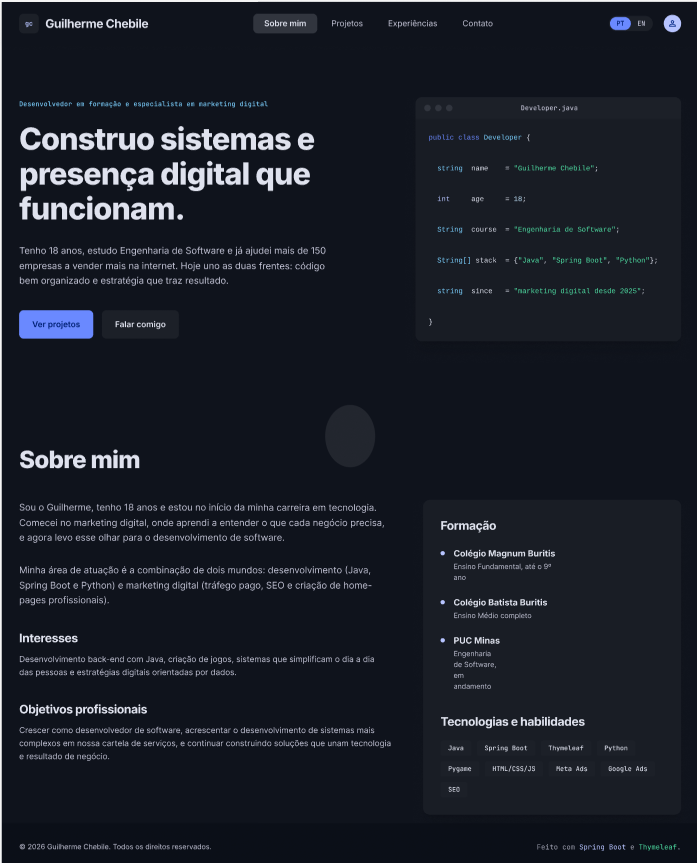
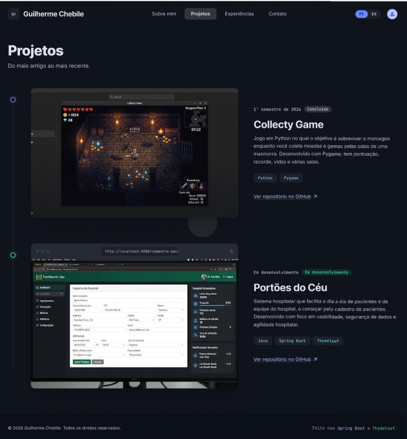
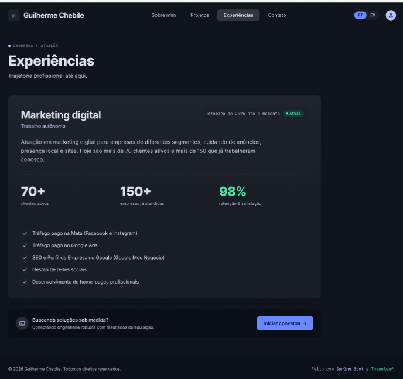
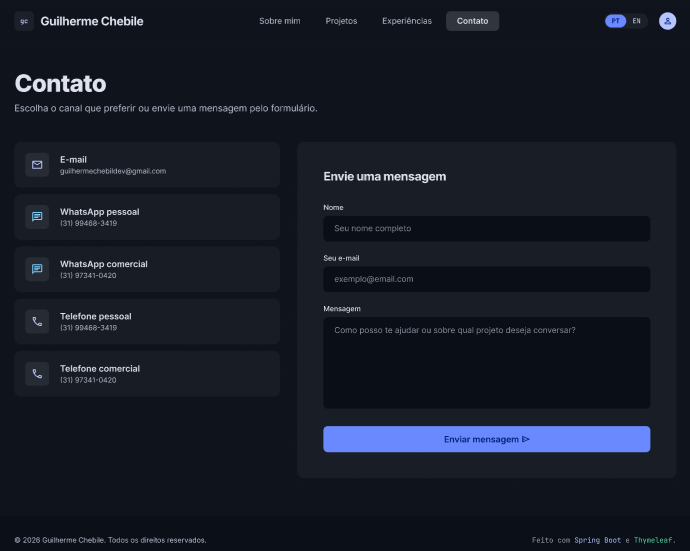

# Portfólio Profissional | Guilherme Chebile

Website de portfólio profissional com seções **Sobre mim**, **Projetos**, **Experiências** e **Contato**, em **português e inglês** (troca no cabeçalho), design responsivo e formulário de contato com envio por e-mail.

> 🔗 **Site publicado:** [guilherme-chebile-dev.onrender.com](https://guilherme-chebile-dev.onrender.com/)
> 📐 **Protótipos (Figma):** [Ver wireframes no Figma](https://www.figma.com/design/tJau4I7cyVXHOHN1klBI45/Sem-t%C3%ADtulo?node-id=0-1&t=SOKiVDWyexawYsY9-1)

> ⏱️ O site fica em um plano gratuito que "dorme" após alguns minutos sem acesso. O primeiro acesso pode levar cerca de 50 segundos para carregar.

## Protótipos

Wireframes de média/alta fidelidade criados no Figma.

### Sobre mim


### Projetos


### Experiências


### Contato


## Funcionalidades

- **Sobre mim:** apresentação, formação, interesses, objetivos e tecnologias.
- **Projetos:** linha do tempo (do mais antigo ao mais recente) com descrição, tecnologias, link do GitHub e imagem de cada projeto.
- **Experiências:** empresa/atividade, cargo, período e descrição.
- **Contato:** ícones clicáveis (e-mail, WhatsApp e telefone) e formulário (nome, e-mail, mensagem) com validação e envio por e-mail.
- **Idioma PT/EN** no cabeçalho, salvo em cookie.
- Layout responsivo, menu mobile, foco visível e suporte a `prefers-reduced-motion`.

## Tecnologias utilizadas

- Java 25 (LTS)
- Spring Boot 3.5 (Spring MVC)
- Thymeleaf (templates no servidor)
- Bean Validation (validação do formulário)
- Resend (envio de e-mail por API HTTP, usado em produção)
- Spring Mail / SMTP com Gmail (envio de e-mail no ambiente local)
- HTML5, CSS3 e JavaScript (sem frameworks no front-end)
- Figma (protótipos)
- Maven, Docker e Render (build e hospedagem)

## Dependências

| Dependência | Uso |
|-------------|-----|
| `spring-boot-starter-web` | Servidor web e controllers |
| `spring-boot-starter-thymeleaf` | Templates HTML |
| `spring-boot-starter-validation` | Validação do formulário |
| `spring-boot-starter-mail` | Envio de e-mail por SMTP (local) |
| `spring-boot-starter-test` | Testes |

O envio pelo Resend usa o `HttpClient` do próprio Java, sem dependência extra.

Fontes (Google Fonts): Sora, IBM Plex Sans e IBM Plex Mono.

## Estrutura de diretórios

```
portfolio/
├── pom.xml
├── Dockerfile
├── README.md
├── docs/                          # imagens dos wireframes
└── src/main/
    ├── java/com/guilherme/portfolio/
    │   ├── PortfolioApplication.java
    │   ├── config/        # I18nConfig (PT/EN) e ContactInfo (contatos)
    │   ├── controller/    # PageController e GlobalModelAdvice
    │   ├── model/         # Project, Experience, Education, ContactForm
    │   └── service/       # PortfolioService (dados) e MailService (e-mail)
    └── resources/
        ├── application.properties
        ├── messages.properties      # textos em português
        ├── messages_en.properties   # textos em inglês
        ├── templates/               # fragments, index, projetos, experiencias, contato
        └── static/                  # css/, js/, img/
```

## Como executar localmente

Pré-requisitos: **JDK 25** e **Maven 3.9+**.

```bash
git clone https://github.com/GuilhermeChebile/Portf-lio-Profissional---Guilherme.git
cd Portf-lio-Profissional---Guilherme
mvn spring-boot:run
```

Acesse http://localhost:8080.

### Envio de e-mail (formulário de contato)

O `MailService` escolhe o modo de envio pelas variáveis de ambiente:

- **Resend (produção):** defina `RESEND_API_KEY` com uma chave criada em resend.com.
- **SMTP/Gmail (local):** defina `MAIL_USERNAME` e `MAIL_PASSWORD` (uma **Senha de app** do Google, com verificação em duas etapas ativa).

```bash
export MAIL_USERNAME="seu-email@gmail.com"
export MAIL_PASSWORD="sua-senha-de-app"
mvn spring-boot:run
```

Sem nenhuma dessas variáveis, o site funciona normalmente, mas o formulário exibe a mensagem de falha no envio. **Nunca** coloque senhas ou chaves no código nem no repositório.

### Editar conteúdo

- Textos (PT/EN): `src/main/resources/messages.properties` e `messages_en.properties`
- Projetos, experiências e formação: `PortfolioService.java`
- Contatos e redes (LinkedIn/GitHub): `application.properties` (`portfolio.contact.*`)
- Imagens dos projetos: `src/main/resources/static/img/`

### Docker

```bash
docker build -t portfolio .
docker run -p 8080:8080 -e RESEND_API_KEY=... portfolio
```

## Deploy

O site está hospedado gratuitamente no **Render**, como Web Service com Docker (usa o `Dockerfile` da raiz do repositório).

- **Link:** https://guilherme-chebile-dev.onrender.com/
- **Variáveis de ambiente configuradas no Render:** `RESEND_API_KEY` e `JAVA_TOOL_OPTIONS`.
- **Por que Resend:** o plano gratuito do Render bloqueia as portas SMTP (25, 465 e 587), então o e-mail é enviado por API HTTP.

## Autor

**Guilherme Luiz Santos Chebile**: guilhermechebiledev@gmail.com